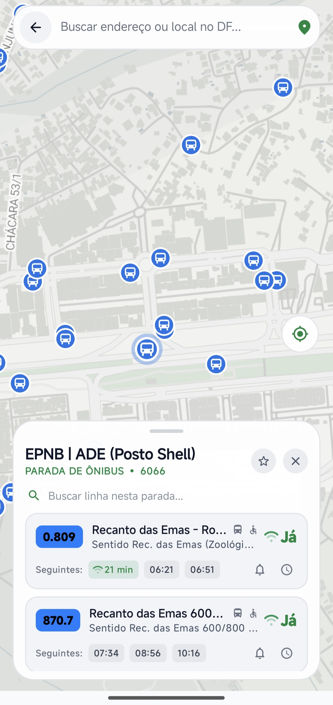
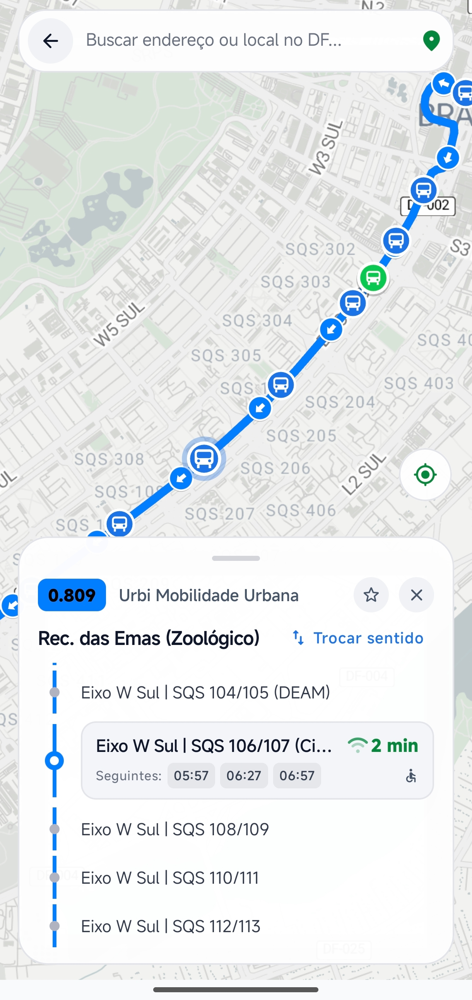
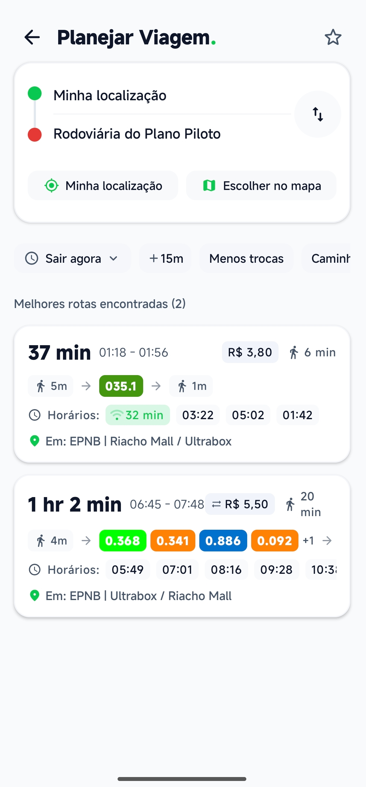
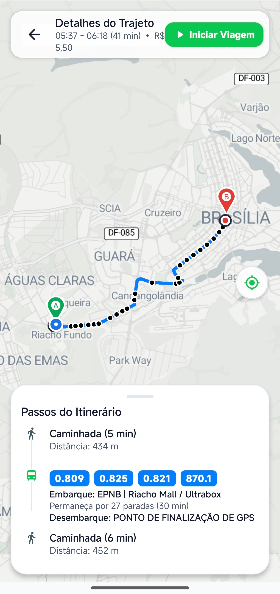
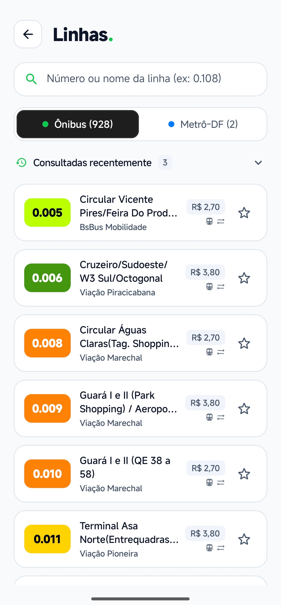
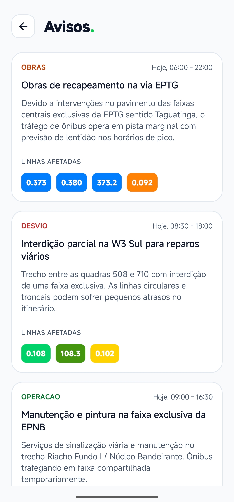

# DFmob

<div align="center">
  
  <br />
  <strong>Mobilidade Urbana do Distrito Federal: Rápida, Aberta e Sem Anúncios</strong>
  <p>Aplicativo nativo Android para consulta de ônibus e metrô em Brasília e regiões administrativas, projetado para máxima performance, funcionamento offline-first, rastreamento de telemetria GPS em tempo real e privacidade total.</p>
</div>

---

## Sumário
- [Visão Geral](#visão-geral)
- [Galeria de Telas](#galeria-de-telas)
- [Principais Funcionalidades](#principais-funcionalidades)
- [Arquitetura e Engenharia](#arquitetura-e-engenharia)
- [Pilares de Privacidade e Desempenho](#pilares-de-privacidade-e-desempenho)
- [Como Compilar e Executar](#como-compilar-e-executar)
- [Fontes de Dados e Agradecimentos](#fontes-de-dados-e-agradecimentos)
- [Licença](#licença)

---

## Visão Geral

O DFmob nasceu da necessidade de um transporte público mais previsível e transparente no Distrito Federal. Enquanto aplicativos comerciais de mobilidade sofrem com excesso de propagandas em tela cheia, coleta invasiva de dados e lentidão no carregamento, o DFmob adota a filosofia de utilitário puro: abrir instantaneamente, exibir a previsão mais precisa de chegada do ônibus via GPS ao vivo e calcular trajetos multimodais eficientes sem depender de servidores intermediários proprietários.

O aplicativo integra a malha completa de ônibus gerenciada pela SEMOB-DF e as duas linhas do Metrô-DF, oferecendo tanto itinerários completos quanto horários programados e posições de veículos em tempo real.

---

## Galeria de Telas

<table align="center">
  <tr>
    <td align="center" width="33%">
      <br />
      <b>Tela Inicial</b><br />
      Busca rápida, favoritos com apelidos e paradas recentes.
    </td>
    <td align="center" width="33%">
      <br />
      <b>Chegadas na Parada</b><br />
      Previsões com GPS ao vivo, indicador de telemetria e próximas viagens.
    </td>
    <td align="center" width="33%">
      <br />
      <b>Itinerário no Mapa</b><br />
      Traçado oficial, sentido ida/volta e acompanhamento de veículos.
    </td>
  </tr>
  <tr>
    <td align="center" width="33%">
      <br />
      <b>Planejamento de Viagens</b><br />
      Rotas multimodais, integração tarifária e opções de horário.
    </td>
    <td align="center" width="33%">
      <br />
      <b>Detalhes da Rota</b><br />
      Passos de caminhada, paradas intermediárias e navegação assistida.
    </td>
    <td align="center" width="33%">
      <br />
      <b>Catálogo Completo</b><br />
      Mais de 900 linhas com tarifas vigentes e busca instantânea.
    </td>
  </tr>
  <tr>
    <td align="center" colspan="3">
      <br />
      <b>Avisos e Ocorrências</b><br />
      Obras, desvios e alterações operacionais com lista de linhas afetadas.
    </td>
  </tr>
</table>

---

## Principais Funcionalidades

### 1. Telemetria GPS em Tempo Real
- Rastreamento dos veículos das concessionárias do DF (Piracicabana, Pioneira, Urbi, Marechal e BsBus).
- Indicação clara de chegadas baseadas em GPS ativo com indicador animado de conexão direta.
- Previsão de minutos restantes sincronizada em segundo plano com algoritmo de interpolação e filtragem de saltos de GPS.

### 2. Catálogo Completo e Busca Instantânea Offline
- Mais de 900 linhas de ônibus e as linhas Verde e Laranja do Metrô-DF.
- Banco de dados local SQLite integrado com FTS5 (Full-Text Search), permitindo buscar números, destinos ou nomes de paradas sem gastar dados móveis.
- Informações completas de tarifas oficiais do DF (R$ 2,70, R$ 3,80 e R$ 5,50), além de operadores e sentidos.

### 3. Planejador de Viagens Multimodal
- Cálculo de rotas combinando caminhadas, múltiplas linhas de ônibus e metrô.
- Suporte a filtros de viagem: menor tempo, menos trocas de condução ou menor caminhada.
- Cálculo de integração tarifária do Bilhete Único do Distrito Federal, indicando se a baldeação está coberta pela integração.

### 4. Alarme Inteligente de Desembarque
- Monitoramento contínuo da distância até o ponto de descida durante a viagem.
- Escolha da antecedência do alerta (1 parada / 250m, 2 paradas / 400m ou 3 paradas / 600m).
- Emissão de vibração háptica contínua e sinal sonoro configurado no canal de notificações prioritárias para garantir que o passageiro não perca sua parada.

### 5. Avisos Operacionais e Ocorrências
- Feed de avisos da malha viária do DF (obras no EPTG, manutenções em faixas exclusivas, desvios e eventos).
- Mapeamento direto das linhas impactadas por cada interdição.

### 6. Atualizador Integrado Direto pelo App
- Módulo nativo na tela de configurações conectado diretamente aos releases do GitHub.
- Download em segundo plano com barra de progresso visual e acionamento seguro do instalador de pacotes do Android via FileProvider.

---

## Arquitetura e Engenharia

O projeto foi construído seguindo as melhores práticas recomendadas pela Google e princípios de engenharia orientada a eficiência extrema:

- **Linguagem**: Kotlin 1.9+.
- **Interface Declarativa**: Jetpack Compose com Material Design 3 e suporte nativo a temas Claro e Escuro.
- **Renderização Cartográfica**: MapLibre Native Android SDK com aceleração por GPU, utilizando estilos vetoriais customizados e leves.
- **Padrão Arquitetural**: MVVM (Model-View-ViewModel) desacoplado com unidirectional data flow (UDF) via StateFlow e SharedFlow.
- **Camada de Dados**:
  - Room / SQLite local com suporte nativo a extensões FTS5.
  - Coordenadas geográficas compactadas em inteiros de 32 bits (latitude e longitude multiplicadas por 10^6), minimizando uso de memória e alocação de objetos no Garbage Collector.
  - OkHttp 4 com HTTP/2 multiplexado e cache com controle de ETag para requisições de telemetria.
- **Concorrência e Assincronia**: Kotlin Coroutines com structured concurrency.

---

## Pilares de Privacidade e Desempenho

| Aspecto | DFmob | Apps Convencionais de Mobilidade |
| :--- | :--- | :--- |
| **Anúncios** | Zero anúncios, banners ou pop-ups | Banners constantes e anúncios em vídeo |
| **Telemetria e Trackers** | Nenhum SDK de analytics ou rastreamento | 5 a 15 SDKs de rastreamento de terceiros |
| **Funcionamento Offline** | Linhas, horários e rotas salvos localmente | Exige conexão constante para qualquer consulta |
| **Tempo de Abertura (Cold Start)** | Menor que 500 ms | Frequentemente acima de 3 a 5 segundos |
| **Consumo de Bateria** | Otimizado via polling adaptativo e GPS passivo | Alto consumo por serviços em segundo plano contínuos |

---

## Como Compilar e Executar

### Pré-requisitos
- Android Studio Hedgehog (2023.1.1) ou superior.
- JDK 17 (Java Development Kit).
- Dispositivo físico ou emulador com Android 8.0 (API nível 26) ou superior.

### Passo a Passo

1. Clone o repositório:
```bash
git clone https://github.com/Daniel-Alvess/DFmob.git
cd DFmob
```

2. Crie ou configure o arquivo `local.properties` na raiz do projeto:
```properties
sdk.dir=/caminho/para/o/seu/android-sdk
CARTO_API_KEY=sua_chave_opcional
STADIA_API_KEY=sua_chave_opcional
MOOVIT_API_KEY=sua_chave_opcional
MOOVIT_USER_KEY=sua_chave_opcional
```

3. Compile o projeto e gere o APK de Release:
```bash
# No Windows:
.\gradlew.bat assembleRelease

# No Linux / macOS:
./gradlew assembleRelease
```

O arquivo gerado estará disponível em `app/build/outputs/apk/release/app-release.apk`.

---

## Fontes de Dados e Agradecimentos

O DFmob consome e processa dados abertos oficiais disponibilizados pelas entidades públicas de mobilidade urbana do Distrito Federal:
- **SEMOB-DF (Secretaria de Transporte e Mobilidade do DF)**: Dados do sistema de transporte público coletivo e especificações GTFS.
- **DF no Ponto**: Barramento de telemetria e previsão estimada de veículos.
- **Metrô-DF**: Dados operacionais e traçado das linhas metroviárias de Brasília.
- **OpenStreetMap & MapLibre**: Dados geoespaciais e biblioteca de renderização vetorial.

---

## Licença

Este projeto é disponibilizado sob a licença [Apache 2.0](LICENSE).
